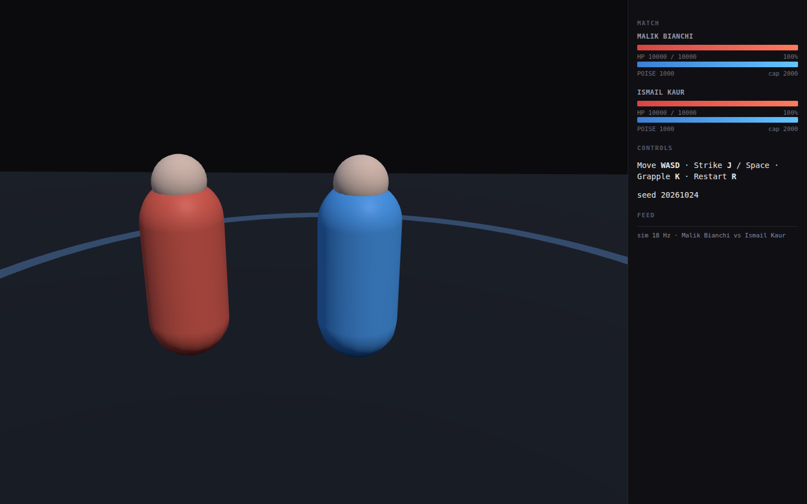

# WR3D Rebuild

A 3D wrestling game rebuilt from first principles — one verified mechanics core
shared by a browser build and a Roblox build.

**[▶ Play in the browser](https://pantha704.github.io/wr3d/)** *(live after first deploy)*



## What makes this different

The simulation is **numerically specified**, not vibes. Every formula carries a
line citation into the reference analysis (`docs/WR3D-FULL-SPEC.md` — 5,947
lines, 271 citations), and both the TypeScript and Luau implementations must
reproduce the same conformance suite:

```bash
pnpm --dir web test                        # 17 tests, 210 vectors
lune run roblox/tests/conformance.luau     # 213 assertions, same vectors
```

Change a formula on one platform and CI fails on the other. That is the whole
trick.

## Structure

```
web/        Vite + TypeScript + Three.js (browser build)
roblox/     Rojo + Luau (Roblox build)
shared/     generated roster + conformance vectors (the contract)
docs/       mechanics spec, build plan, implementation plan
tools/      roster parser/generator, vector generator
private/    reference-only data, gitignored, never shipped
```

## Design decisions

| Decision | Why |
|---|---|
| Fixed **18 Hz** sim tick, render interpolates | the reference engine is frame-locked; a variable timestep breaks parity |
| One seeded PRNG (`mulberry32`) | reproducible matches, testable, identical on both platforms |
| `Rnd(min,max) = round(rnd*(max-min))+min` | matches the reference distribution — endpoints get half weight |
| 1-indexed stat arrays at the boundary only | mirrors the reference, 0-indexed internally |
| No backend, no telemetry | static hosting, saves in IndexedDB, nothing to breach |
| Generated roster | original IP only — see `NOTICE` |

## Local development

```bash
pnpm --dir web install
pnpm --dir web dev        # http://127.0.0.1:5173

rojo serve roblox/default.project.json   # then connect from Roblox Studio

python3 tools/gen_roster.py              # regenerate the shipped roster
python3 tools/gen_vectors.py             # regenerate conformance vectors
```

## Status

| Milestone | State |
|---|---|
| Mechanics spec | ✅ 271 citations |
| Sim core (web + Luau) | ✅ conformance green |
| Original roster | ✅ 300 generated wrestlers |
| Playable match | ✅ keyboard + AI, deterministic (17 tests) |
| Public deploy | 🚧 workflow ready, waiting on remote |
| Art pass | 🚧 capsules |

Roadmap, risk register and quality gates: [`docs/PLAN.md`](docs/PLAN.md).

## Contributing

Read `CONTRIBUTING.md` — the short version: both platforms must pass the same
vectors in the same PR, and no third-party game data is accepted (`NOTICE`).

## License

Code and vectors: MIT (`LICENSE`). No assets or roster data from any commercial
game are included.
